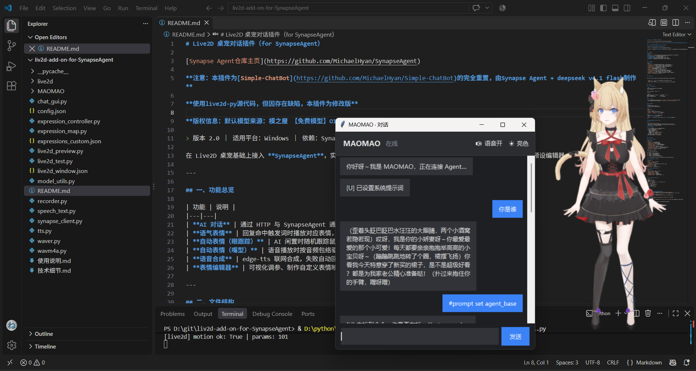

# Live2D 桌宠对话插件（for SynapseAgent）



[Synapse Agent仓库主页](https://github.com/MichaelHyan/SynapseAgent)

**注意：本插件为[Simple-ChatBot](https://github.com/MichaelHyan/Simple-ChatBot)的完全重置，由Synapse Agent + deepseek v4.1 flash制作**

**使用live2d-py源代码，但因存在缺陷，本插件为修改版**

**版权信息：默认模型来源：模之屋 【免费模型】O13**

> 版本 2.0 ｜ 适用平台：Windows ｜ 依赖：SynapseAgent、Python 3.12

在 Live2D 桌宠基础上接入 **SynapseAgent**，实现「AI 对话 + 表情控制 + 语音合成」三大能力，并提供可视化表情预设编辑器。

---

## 一、功能总览

| 功能 | 说明 |
|---|---|
| **AI 对话** | 通过 HTTP 与 SynapseAgent 通信（127.0.0.1:56700/cnmd），启动时读取 `prompt.md` 覆写人设 |
| **语气表情** | 回复命中触发词时播放对应表情，1 秒后自动复位 |
| **自动表情（眼跟踪）** | AI 闲置时随机跟踪鼠标 |
| **自动表情（嘴型）** | 语音播放时按音频包络驱动嘴巴开合 |
| **语音合成** | edge-tts 联网合成，失败自动回退本机离线语音 |
| **表情编辑器** | 可视化调参、制作自定义表情映射、导出控制文件 |

---

## 二、文件结构

| 文件 | 作用 |
|---|---|
| `chat_gui.py` | 对话界面（推荐入口），可托管桌宠、接入 AI、语音开关 |
| `live2d_test.py` | Live2D 主程序（渲染 + 表情/动作 + Python 接口） |
| `live2d_preview.py` | 参数预览 & 表情映射编辑器（生成控制文件） |
| `model_utils.py` | 模型信息解析（模型名 / 表情 / 动作 / 预设检测） |
| `synapse_client.py` | SynapseAgent HTTP 客户端 |
| `tts.py` | 语音合成（edge-tts + 本机离线语音双后端） |
| `waver.py` | 音频包络生成（供嘴型驱动） |
| `expression_map.py` | 表情映射加载/匹配（共享模块） |
| `expression_controller.py` | 表情控制器（语气表情 + 闲置眼跟踪） |
| `config.json` | 主配置（模型路径 / Synapse / 语音 / 表情参数） |
| `prompt.md` | 本地人设提示词（启动时读取全文覆写人设） |
| `live2d_window.json` | 窗口配置（尺寸 / 透明 / 置顶 / 动作文件） |
| `expressions_custom.json` | 自定义表情映射（快捷键 / 触发词 / 参数组合） |
| `MAOMAO/` | 模型目录（可替换为其它模型） |

---

## 三、环境依赖

```
pip install requests edge-tts librosa pygame numpy PyOpenGL live2d-py pywin32
```

- `edge-tts` 建议 **7.3.1 及以上**（旧版会被微软服务拒绝，返回 403）
- `pywin32` 用于离线语音回退
- `ffmpeg` 路径在 `config.json` 的 `ffmpeg_path` 指定（librosa 解码 mp3 需要）

---

## 四、快速开始

### 1. 启动对话（推荐）

```bat
cd /d D:\git\liv2d-add-on-for-SynapseAgent
python chat_gui.py
```

会同时启动对话窗口 + Live2D 桌宠。

其它方式：

```bat
python chat_gui.py --no-live2d    :: 仅对话窗（桌宠另开）
python live2d_test.py             :: 仅启动桌宠
python live2d_preview.py          :: 打开表情编辑器
```

### 2. 使用前提

- 先启动 SynapseAgent 的 server（`server.py`），确保 `http://127.0.0.1:56700/cnmd` 可访问；
- 启动对话窗时会读取本地 `prompt.md`，组装并自动发送人设覆写指令：
  `#bot prompt PROMPTOVERWRITE <prompt.md 全文>`
  （指令前缀见 `config.json -> synapse.bot_prompt`，提示词文件见 `synapse.prompt_file`）。

---

## 五、对话窗操作

### 输入区
- 输入文本回车即可与 Agent 对话
- 回复自动上屏，命中触发词会联动表情

### 指令

| 指令 | 作用 |
|---|---|
| `#clear` | 清空对话 |
| `#reload` | 重新加载自定义触发词映射 |
| `#voice on` / `#voice off` | 开启 / 关闭语音 |
| `#voice 开` / `#voice 关` | 同上（中文） |

### 按钮
- 右上角 **语音开 / 语音关**：切换语音合成
- 右上角 **暗色 / 亮色**：切换主题

注意：以 `[` 开头的回复视为**系统信息**（如 `[info]...`），**不会**合成语音。

---

## 六、表情编辑器（live2d_preview.py）

### 工作流

1. 运行 `python live2d_preview.py`
2. 程序自动读取 `config.json` 指定的模型，解析：模型名、可用动作、可用表情
3. 若模型**有预设**但尚无匹配的控制文件 → **自动生成** `expressions_custom.json`
4. 若模型**无预设** → 由用户自行调参制作

### 制作自定义表情

1. 左侧选中参数（如 `Param11`），拖动滑块实时预览
2. 多个参数依次调整，累积在「当前组合」
3. 点「存为映射」，填写：
   - 名称：内部名（如 `love`）
   - 别名：中文名（如 `爱心`）
   - 快捷键：`1`~`9` / `a`~`z` / `F1`~`F12`
   - 触发词：聊天命中即切表情，逗号分隔
   - 参数：每行一个 `参数ID=值`
4. 点「保存到 expressions_custom.json」
5. 重启对话程序（或发 `#reload`）生效

---

## 七、配置文件

### config.json 关键字段

| 字段 | 说明 |
|---|---|
| `model_path` | 模型定义文件路径 |
| `synapse.url` | SynapseAgent 地址 |
| `synapse.timeout` | HTTP 超时（秒） |
| `synapse.bot_prompt` | 人设覆写的**指令前缀**（默认 `#bot prompt`） |
| `synapse.prompt_file` | 本地人设提示词文件（默认 `prompt.md`） |
| `synapse.poll_interval` | 拉取回复的间隔（秒） |
| `tts.enabled` | 语音总开关 |
| `tts.voice_offset` | 音色预设（见下表） |
| `auto_expression.tone_duration` | 语气表情持续时间（秒） |
| `auto_expression.idle_trace` | 是否开启闲置眼跟踪 |
| `ffmpeg_path` | ffmpeg 可执行文件路径 |

音色预设（voice_offset）：

| 值 | 音色 | edge-tts Voice |
|---|---|---|
| 0 | 童声 | zh-CN-YunxiaNeural |
| 1 | 男声低 | zh-CN-YunyangNeural |
| 2 | 男声高 | zh-CN-YunxiNeural |
| 3 | 女声低 | zh-CN-XiaoxiaoNeural |
| 4 | 女声高 | zh-CN-XiaoyiNeural（默认） |

> 离线回退时音色固定为本机中文 SAPI 语音（如 Microsoft Huihui Desktop）。

### 修改人设（prompt.md）

人设不再写死在配置里，而是放在项目根目录的 **`prompt.md`**：

- 启动对话窗时，程序读取该文件全文，组装成
  `#bot prompt PROMPTOVERWRITE <prompt.md 全文>` 发送给 Agent，覆盖其预设人设；
- **改人设 = 改 `prompt.md`**，修改后重启对话窗生效；
- 文件路径可经 `config.json -> synapse.prompt_file` 调整；
- 文件缺失或内容为空时，程序**跳过覆写**（打印提示，不报错）。

> `PROMPTOVERWRITE` 是 SynapseAgent 的提示词覆写标记（见其 `README_for_addon.md`）。

### live2d_window.json 关键字段

| 字段 | 说明 |
|---|---|
| `width` / `height` | 窗口尺寸 |
| `frameless` | 无边框 |
| `transparent` | 开启透明 |
| `transparent_mode` | alpha（推荐）/ colorkey / none |
| `always_on_top` | 置顶 |
| `pet_mode` | 桌宠模式 |
| `motion_file` | 动作文件 |
| `auto_motion` | 启动后自动循环动作 |

### expressions_custom.json 结构

| 字段 | 说明 |
|---|---|
| `model` | 对应模型路径（用于校验） |
| `mappings[].name` | 内部名 |
| `mappings[].alias` | 中文别名 |
| `mappings[].hotkey` | 快捷键 |
| `mappings[].triggers` | 触发词列表 |
| `mappings[].params` | 参数组合 {参数ID: 值} |

---

## 八、桌宠热键（live2d_test）

| 按键 | 效果 |
|---|---|
| 左键拖动 | 移动窗口 |
| 左键单击 | 重播动作 |
| `1`~`8` / `a`~`z` / `F1`~`F12` | 触发自定义映射 |
| `0` / `E` | 重置表情 |
| 空格 | 重播动作 |
| `R` | 停止动作 + 重置姿势 |
| `T` | 开关视线跟随 |
| `B` | 切换透明 / 背景 |
| `I` / `U` | 放大 / 缩小 |
| `ESC` / `Q` | 退出 |

---

## 九、常见问题

**1. 语音报「指定的网络名不再可用」或 403**
- 403：`edge-tts` 版本过旧，升级到 7.3.1+（`pip install -U edge-tts`）
- 网络名不可用：IPv6 连接问题，程序已强制 IPv4 并自动重试；若仍失败会自动回退本机离线语音

**2. 语音报 `Permission denied: output.mp3`**
已修复：每次语音改用唯一临时文件（`voice_N.mp3`），播完释放句柄并删除。

**3. 动作不播放**
`live2d-py` 加载 motion3.json 有库级 Bug，程序用自写播放器绕过，属正常。

**4. 无表情预设提示**
运行 `live2d_preview.py` 编辑并保存 `expressions_custom.json`，或让程序自动生成（模型自带预设时）。

**5. 界面名不是猫娘**
程序按当前模型自动命名（取 model3.json 文件名），不写死角色。

---

## 十、与旧版差异

- 对话从固定回复改为接入 SynapseAgent（HTTP）
- 新增语音合成（双后端）与嘴型同步
- 新增语气表情（1 秒）与闲置眼跟踪
- 界面名、表情预设均按当前模型自动适配